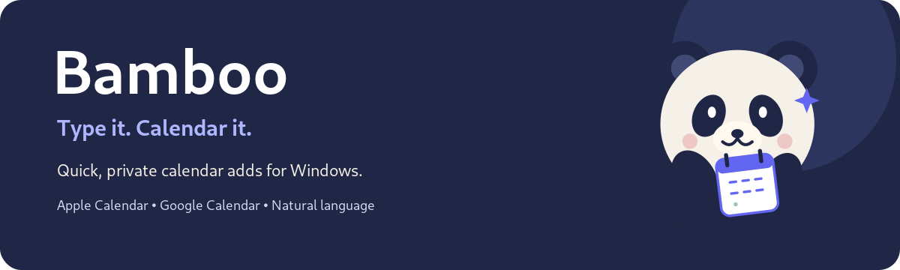
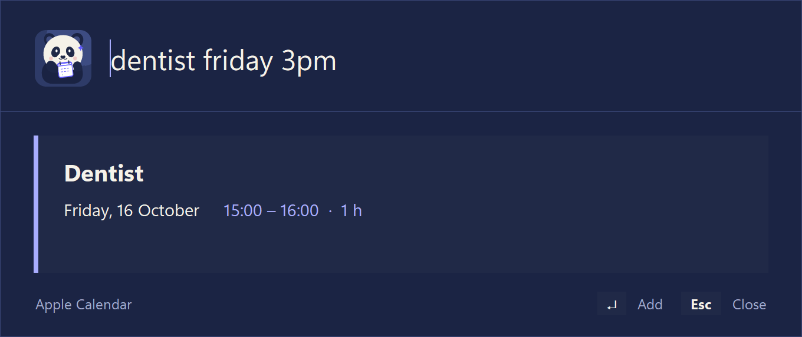

# Bamboo

<p align="center">
  
</p>

Bamboo is a Windows tray app that adds calendar events from a sentence you type. Press a hotkey, type `dentist friday 3pm`, check the preview, press Enter. The event goes to Apple Calendar or Google Calendar without you opening either one.

<p align="center">
  
</p>

Status: it works on the author's machine (Windows 11, Python 3.11). It has not been tested on other setups, and there is no packaged installer.

## What it does

- Reads plain English: dates, times, ranges, lengths, repeats, and whole weeks or months.
- Shows what it understood before anything is saved, including any guess it made.
- Adds events to Apple Calendar (CalDAV) and Google Calendar.
- Opens from a global hotkey (`Ctrl+Alt+C` by default) and sits in the tray when idle.
- Keeps your Apple password and Google sign-in encrypted with a passphrase you choose.

### Examples

| You type | Bamboo understands |
|---|---|
| `dentist friday 3pm` | the next Friday, 15:00 to 16:00 |
| `lunch with Sam tomorrow at 12:30` | tomorrow, 12:30 to 13:30 |
| `workshop from 9:30 180 minutes tomorrow` | tomorrow, 09:30 to 12:30 |
| `meeting friday 9 until 11` | Friday, 09:00 to 11:00 |
| `holiday today until 31st october` | an all-day event from today to 31 October |
| `conference tomorrow morning 9 until 31 october 12 pm` | starts tomorrow at 09:00, ends 31 October at 12:00 |
| `yoga every monday 7am` | repeats every Monday at 07:00 |
| `workshop next week` | an all-day event, Monday to Sunday of next week |
| `review tomorrow 5pm /google` | goes to Google Calendar, for this event only |

Without a time, an event is all-day. Without a length, it lasts one hour (changeable in settings). A bare "5" is read as 5 pm, and the card tells you when it makes a guess like that.

## Requirements

- Windows. It uses Windows-only calls (global hotkey, tray, startup shortcuts), so it will not run on macOS or Linux.
- Python 3.11 with tkinter. The installer from python.org includes tkinter. Other Python versions are untested.
- Internet access when you add an event to Apple or Google. Parsing happens locally.
- For Apple Calendar: an app-specific password (see below).

## Install

```powershell
git clone https://github.com/Siddhartha-Kolla/Bamboo.git bamboo
cd bamboo
python -m venv .venv
.venv\Scripts\pip install -r requirements.txt
.\bamboo start
```

`.\bamboo` runs `bamboo.bat` in the project folder. It works in PowerShell and in `cmd.exe`, but only from that folder.

Bamboo runs as `pythonw.exe bamboo.py` from the `.venv` in this folder. It is not compiled, so after changing code you only need `.\bamboo restart`.

## Use it

Press `Ctrl+Alt+C` or choose "Add an event" from the tray icon. Type a sentence and read the card. Enter saves, Esc closes.

| Command | What it does |
|---|---|
| `.\bamboo start` | Start Bamboo in the background |
| `.\bamboo stop` | Ask the running copy to quit |
| `.\bamboo restart` | Stop and start again, which loads changed code |
| `.\bamboo status` | Show whether it is running and whether it starts with Windows |
| `.\bamboo autostart on` | Start it when you log in (`off` removes the shortcut) |
| `.\bamboo log` | Print the end of the log file |

Only one copy runs at a time. The tray menu also has Settings, Restart, a "Start with Windows" switch, and Quit.

### Slash commands

Typing `/` instead of an event opens a command. `Tab` completes the name.

| Command | What it does |
|---|---|
| `/settings` | Open the settings window |
| `/status` | Show the default calendar, vault state, timezone, and hotkey |
| `/apple`, `/google` | Make that calendar the default |
| `/target` | Show or set the default calendar |
| `/lock` | Forget the passphrase now |
| `/log`, `/restart`, `/quit` | Open the log, restart, stop |
| `... /google` or `... /apple` at the end of an event | Send just that event there |

## Connect a calendar

Open settings with `/settings` or from the tray. The first time you store a password or sign in, Bamboo asks you to choose a passphrase. There is no way to recover it. After 30 minutes without use (configurable) Bamboo forgets it and asks again.

### Apple Calendar

1. Sign in at appleid.apple.com, open Sign-In and Security, then App-Specific Passwords, and create one. It is separate from your Apple ID password and you can revoke it there.
2. In settings, open Accounts, enter your Apple ID and that password, and press Connect.
3. Choose a calendar and press Save.

### Google Calendar

There are three routes, depending on how this copy of Bamboo is set up.

- Sign in with Google. This adds events automatically and needs a Google client (see "Set up Google sign-in" below). This repository does not include one, so it only works if the person who distributes Bamboo adds one.
- Open events in the browser. Under Accounts, Advanced options, "Open events in my browser" needs no sign-in. Each event opens a prefilled Google Calendar page and you press Save there. That is one extra click per event, and you pick the calendar in Google's form.
- Your own Google project. Create a client yourself, paste its ID and secret under Advanced options, then sign in. The in-app Setup guide lists the steps.

## Configuration

Everything below is in the settings window. The values live in `~/.bamboo.json`.

| Setting | Default | Notes |
|---|---|---|
| Default calendar | first one connected | A one-off `/apple` or `/google` overrides it |
| Event length | 60 minutes | Used when you type no length |
| Passphrase timeout | 30 minutes | How long Bamboo stays unlocked after the last use |
| Timezone | automatic | Uses the PC's timezone, or an IANA name such as `Europe/Berlin` |
| Hotkey | `ctrl+alt+C` | Needs Ctrl, Alt, or Win. Restart Bamboo after changing it |
| Friendly messages | on | Short, warmer wording on cards. Turn off for plain text |

## Privacy and security

Bamboo has no server of its own. It talks to Apple or Google directly from your PC, and only when you add an event, load calendars, or sign in. The code makes no other network calls.

| What | Where | Stored as |
|---|---|---|
| Apple app-specific password | `~/.bamboo.vault` | Encrypted with a key derived from your passphrase (scrypt, then Fernet) |
| Google sign-in token | `~/.bamboo.vault` | Same vault |
| Apple ID, calendar names, preferences | `~/.bamboo.json` | Plain JSON, no secrets |
| Events that failed to save | `Documents\Bamboo` | Plain `.ics` files |
| Log | `~/.bamboo.log` | Plain text. Bamboo itself does not write passwords or tokens to it |

The passphrase is never written to disk. While the vault is unlocked its key is held in memory, so a program already running as your Windows user could read it. Encryption protects the files, not a compromised session.

Passwords go to Windows Credential Manager instead only if you run `python icloud.py setup --keyring`, which skips the passphrase.

## Set up Google sign-in

Only the person who distributes Bamboo needs to do this, once. Google must know which application is asking, so this registers Bamboo with Google. The client ID and secret are not a key to anyone's calendar. Each person still approves access themselves.

1. Create a project in the Google Cloud Console and name it Bamboo. Users see this name when they sign in.
2. In APIs & Services, Library, enable the Google Calendar API.
3. Under OAuth consent screen, choose External, set the app name and a support e-mail, and add the permission `https://www.googleapis.com/auth/calendar.events`. `assets/png/tile-512.png` is a square logo you can upload.
4. Under Credentials, create an OAuth client ID of type Desktop app.
5. Copy `google_client.example.json` to `google_client.json` in the project folder and fill in the client ID and secret.
6. On the consent screen, publish the app. While it stays in Testing status, Google ends sign-ins after 7 days.

People will see a "Google hasn't verified this app" page once. They continue through Advanced. Removing that page needs Google's verification process, which this project has not been through.

The same steps appear in the app under Accounts, Advanced options, Setup guide. These steps follow Google's documented flow but have not been run end to end against a real Google project in this repository.

## Resource use

These numbers were measured on one machine (Windows 11, Python 3.11.9) and will differ on yours. "Working set" is what Task Manager shows. "Private" is the part not shared with other programs.

| What | Measured |
|---|---|
| Memory, running in the tray, popup hidden | about 45 MB working set and 25 MB private right after a start, about 53 MB and 40 MB on a copy that had been in use |
| Launcher process (there are two processes) | about 5 MB working set, 1 MB private |
| CPU while idle | about 0.1% of one core (0.016 s of CPU time in 15 s) |
| Disk, project files | about 0.7 MB |
| Disk, the `.venv` | about 110 MB |
| Disk, your data | a few hundred bytes in `~/.bamboo.json` and `~/.bamboo.vault` |

Most parts load only when first needed, so memory grows a little with use. On a popup without the tray icon, the measured steps were:

| Step | Working set | Private |
|---|---|---|
| Popup built and hidden | about 36 MB | about 20 MB |
| After the first typed event (the date parser loads) | about 42 MB | about 25 MB |
| After loading the Apple libraries | about 47 MB | about 29 MB |
| After loading the Google module | about 61 MB | about 43 MB |

Idle CPU is low because Bamboo waits for the hotkey and checks its internal queue every 150 ms. The first sentence you type after a start takes noticeably longer while the parser loads (0.2 to 0.5 s in the test runs). After that, parsing takes a few milliseconds. The settings window is built when you open it and destroyed when you close it. Its memory use was not measured.

## Limitations

- Windows only, and English phrases only.
- One tested environment: Windows 11, Python 3.11.9. Windows 10 and other Python versions are untested.
- The startup shortcut points into this folder's `.venv`. If you move the folder, run `.\bamboo autostart on` again.
- If another program already uses your hotkey, Bamboo cannot register it. Choose a different one in settings.

### Troubleshooting

| Problem | What to try |
|---|---|
| The hotkey does nothing | Run `.\bamboo log`. A line saying the hotkey could not be registered means another program has it. Change it in settings and restart. |
| Events appear at the wrong hour | Open settings, Defaults, and set the timezone. |
| Google sign-in stopped working after a week | The Google app is still in Testing status. Publish it (step 6 above) and sign in again. |
| You forgot the passphrase | It cannot be recovered. Close Bamboo, delete `%USERPROFILE%\.bamboo.vault`, and connect your calendars again. |

## Development

Run the tests from the project folder. Each prints a pass count, and the UI suite briefly shows real windows, so do not type while it runs. All three use temporary files and never touch your real settings or vault.

```powershell
.venv\Scripts\python eval_calendar.py
.venv\Scripts\python test_backend.py
.venv\Scripts\python test_ui.py
```

| Path | Role |
|---|---|
| `bamboo.py`, `bamboo_ctl.py`, `tray.py`, `singleton.py` | The popup and hotkey, the start/stop commands, the tray icon, the one-copy lock |
| `eventparser.py`, `eventout.py` | Sentence to event (built on `ctparse`), event to `.ics` |
| `calendars.py`, `icloud.py`, `google_cal.py`, `google_link.py` | Where events go |
| `vault.py`, `settings.py`, `paths.py` | Encrypted secrets, preferences, file locations |
| `commands.py`, `settings_window.py`, `voice.py`, `theme.py`, `branding.py` | Slash commands, settings UI, card wording, colors, images |
| `assets/`, `tools/make_assets.py` | The panda artwork and the script that renders its icons |

The icons in `assets/png` and `assets/bamboo.ico` are generated from `assets/bamboo-logo.svg` and committed. To rebuild them, install `requirements-dev.txt` in a separate environment and run `python tools/make_assets.py`.

### Coming from Quick add

Bamboo was called Quick add. On first start it copies the old settings and vault to the new file names, leaves the old files in place, and replaces an old startup shortcut. `quickadd.py` and `qa.bat` are small forwarding files so old shortcuts keep working. You can delete them.

## License

Bamboo is released under the MIT License. See [LICENSE](LICENSE).
